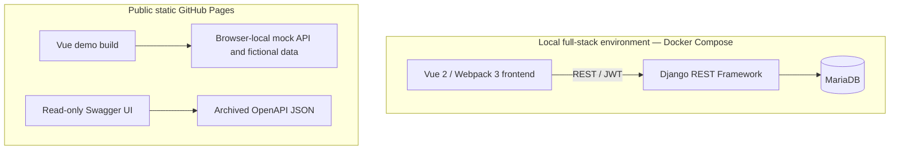

<p align="center">
  
</p>

<h1 align="center">Young & Digital Learning</h1>

<p align="center">
  <strong>Full-stack academic learning platform · Local restoration · Interactive portfolio demo</strong>
</p>

<p align="center">
  <!-- Website Online/Offline -->
  <a target="_blank" rel="noopener noreferrer" href="https://younganddigitallearning.github.io/">
    
  </a>
  <!-- <a target="_blank" rel="noopener noreferrer" href="https://github.com/YoungAndDigitalLearning/younganddigitallearning.github.io/actions/workflows/deploy.yml">
    
  </a> -->
  <!-- API Docs Online/Offline -->
  <a target="_blank" rel="noopener noreferrer" href="https://younganddigitallearning.github.io/ydl-api/">
    
  </a>
  </br>
  <!-- GitHub - Last commit -->
  <a target="_blank" rel="noopener noreferrer" href="https://github.com/YoungAndDigitalLearning/ydl/commits/feature/local-demo">
    
  </a>
</p>

<p align="center">
  <a target="_blank" rel="noopener noreferrer" href="https://github.com/YoungAndDigitalLearning/ydl-front">
    
  </a>
  <a target="_blank" rel="noopener noreferrer" href="https://github.com/YoungAndDigitalLearning/ydl-api">
    
  </a>
</p>

<p align="center">
  <a target="_blank" rel="noopener noreferrer" href="https://younganddigitallearning.github.io/"><strong>Launch Interactive Demo</strong></a>
  ·
  <a target="_blank" rel="noopener noreferrer" href="https://younganddigitallearning.github.io/ydl-api/"><strong>Browse REST API Reference</strong></a>
  ·
  <a target="_blank" rel="noopener noreferrer" href="https://github.com/YoungAndDigitalLearning"><strong>View Project Portfolio</strong></a>
</p>

## About the Project

**Young & Digital Learning (YDL)** was developed for the _Programming Lab: Social Networking_ at **Technische Universität Berlin (TU Berlin)** in collaboration with the **Sprach- und Kulturbörse (SKB)**.

The original application combines a **Vue 2** frontend, a **Django REST Framework** API, and a **MariaDB** database. It supports course discovery and enrollment, course discussions, quizzes, calendars, learning resources, and teacher-facing course management.

The legacy project has been restored as a local, Docker-based full-stack environment. Fictional seed data and Playwright screenshots make its features reproducible for documentation and portfolio purposes.

## Try the Application

| Experience                      | Link                                                               | What to expect                                                                                         |
| ------------------------------- | ------------------------------------------------------------------ | ------------------------------------------------------------------------------------------------------ |
| **Interactive browser demo**    | [Launch demo](https://younganddigitallearning.github.io/)          | Static Vue application with fictional data, simulated Student/Teacher roles, and browser-local changes |
| **Archived REST API reference** | [Swagger UI](https://younganddigitallearning.github.io/ydl-api/)   | Read-only documentation generated from the Django API's OpenAPI specification                          |
| **Project showcase**            | [Organization profile](https://github.com/YoungAndDigitalLearning) | Student, teacher, and mobile screenshots plus technical background                                     |

> **Demo notice:** The public website does not connect to a live Django server. Demo interactions are simulated in the browser; changes are local to that browser and can be reset. The public API reference is documentation only, with request execution disabled.

## Architecture



The original application was also deployed on a self-managed Ubuntu server using Nginx and Gunicorn. The current GitHub Pages demo is a **separate static presentation** of the restored project, not a public deployment of the historical backend.

## Repository Structure

This repository integrates the two source repositories as **Git submodules**:

```text
📦 ydl/
┣ 📂 ydl-front/       # Vue frontend (Git submodule)
┣ 📂 ydl-api/         # Django REST API (Git submodule)
┣ 📂 screenshots/     # Playwright capture workflow
┗ 📄 ...              # Docker Compose and local project tooling
```

| Repository                                                                                                        | Responsibility                                                              |
| ----------------------------------------------------------------------------------------------------------------- | --------------------------------------------------------------------------- |
| [ydl](https://github.com/YoungAndDigitalLearning/ydl)                                                             | Full-stack integration, Docker setup, and screenshots                       |
| [ydl-front](https://github.com/YoungAndDigitalLearning/ydl-front)                                                 | Frontend source and backend-free demo mode                                  |
| [ydl-api](https://github.com/YoungAndDigitalLearning/ydl-api)                                                     | Django API, migrations, fictional seed data, and archived API specification |
| [younganddigitallearning.github.io](https://github.com/YoungAndDigitalLearning/younganddigitallearning.github.io) | Published static frontend build and website deployment                      |
| [.github](https://github.com/YoungAndDigitalLearning/.github)                                                     | Organization profile, portfolio images, and shared documentation            |

## Run Locally

The restored full-stack application uses **Docker Compose** for the legacy runtime and database.

```bash
git clone --recurse-submodules \
  --branch feature/local-demo \
  https://github.com/YoungAndDigitalLearning/ydl.git

cd ydl

docker compose up -d --build
```

Once the services are running, the usual local entry points are:

- **Frontend:** http://127.0.0.1:8080/
- **Django API and Swagger UI:** http://127.0.0.1:8000/

The backend requires the project's local environment configuration, database setup, and fictional demo seed data before all features work. Refer to the repository's Docker/setup documentation rather than using any historical production credentials or database dumps.

### Working with submodules

```bash
# Synchronize submodule URLs and check out the revisions recorded by ydl
git submodule sync --recursive
git submodule update --init --recursive

# Show the revisions recorded by the main repository
git submodule status
```

The main repository pins **specific submodule commits**. After cloning, a submodule may have a detached HEAD; this is normal. To contribute to the development branches, check out `feature/local-demo` **inside each submodule** before editing and push those repositories before updating the submodule pointers in `ydl`.

## Documentation

For detailed technical documentation, architecture diagrams,
repository structure, local development instructions, and
feature walkthroughs, visit the
**[Young & Digital Learning Wiki](https://github.com/YoungAndDigitalLearning/ydl/wiki)**.

The wiki covers both the original academic implementation
and the restored `feature/local-demo` development branches.

## Technology Stack

| Layer                 | Technologies                                               |
| --------------------- | ---------------------------------------------------------- |
| Frontend              | Vue 2, JavaScript, Bootstrap, Sass/SCSS                    |
| Frontend tooling      | Webpack 3, legacy Node.js toolchain                        |
| Backend               | Python, Django 2, Django REST Framework                    |
| Database              | MariaDB                                                    |
| Local environment     | Docker Compose                                             |
| Historical deployment | Ubuntu, Nginx, Gunicorn                                    |
| Documentation         | OpenAPI / Swagger UI, Playwright screenshots, GitHub Pages |

## Academic Background

- **Institution:** Technische Universität Berlin (TU Berlin)
- **Course:** Programming Lab: Social Networking (_Programmierpraktikum Soziale Netzwerke_)
- **Collaboration:** Sprach- und Kulturbörse (SKB)
- **Project:** Academic software engineering application, subsequently restored for technical demonstration

---

_Young & Digital Learning is presented as an academic software engineering project and portfolio reference. Public demo accounts and content are fictional. Historical deployment information is preserved for context, not as a currently operated production service._
